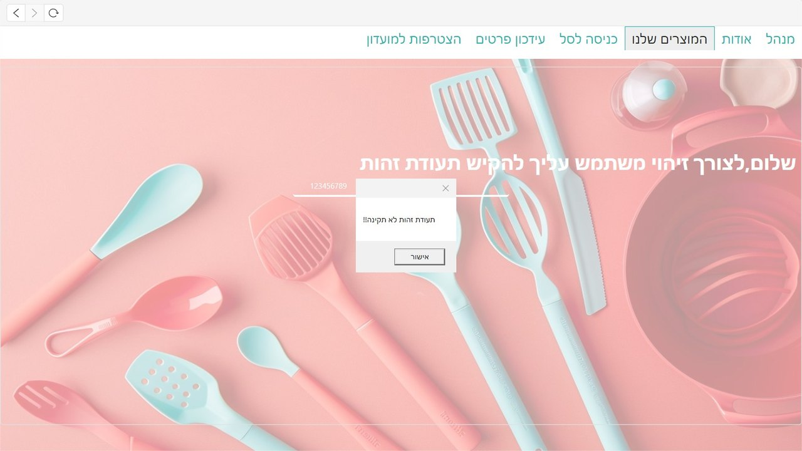
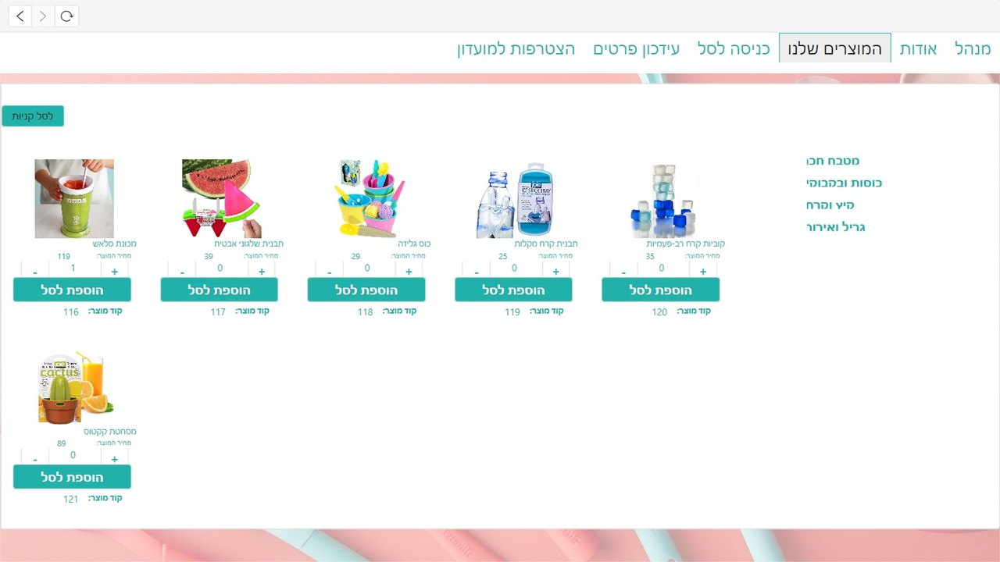
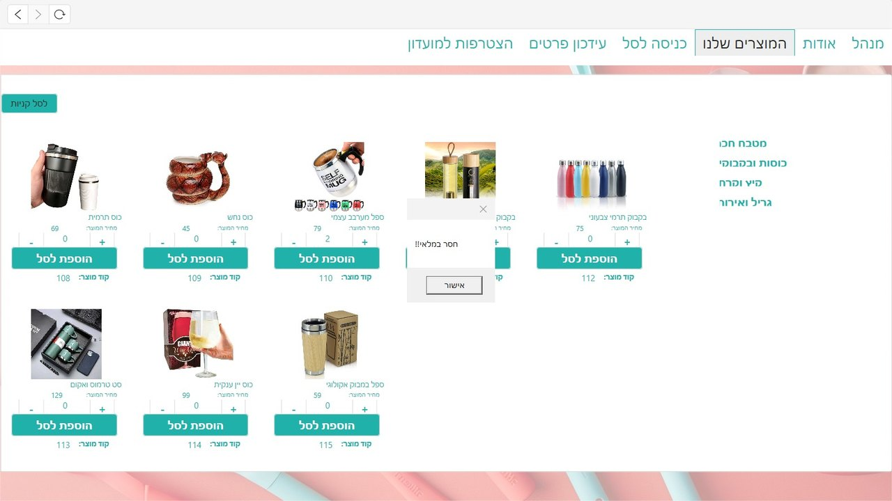
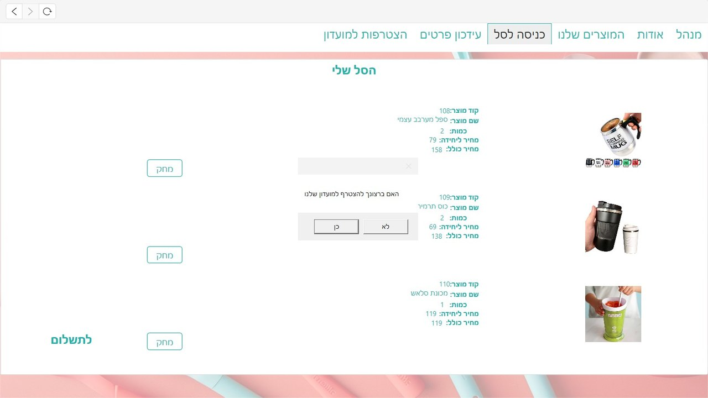
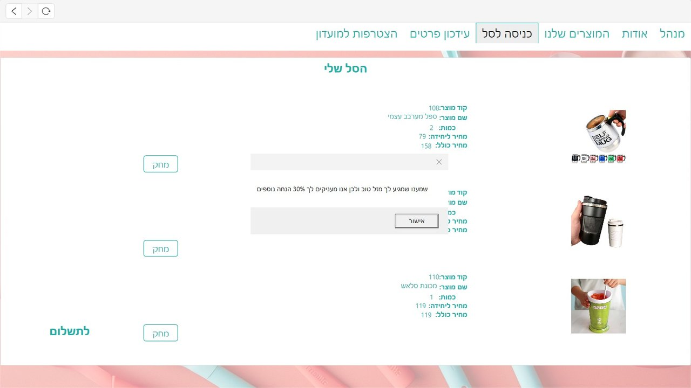
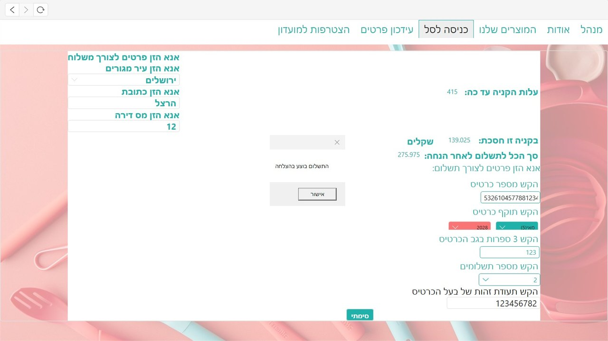
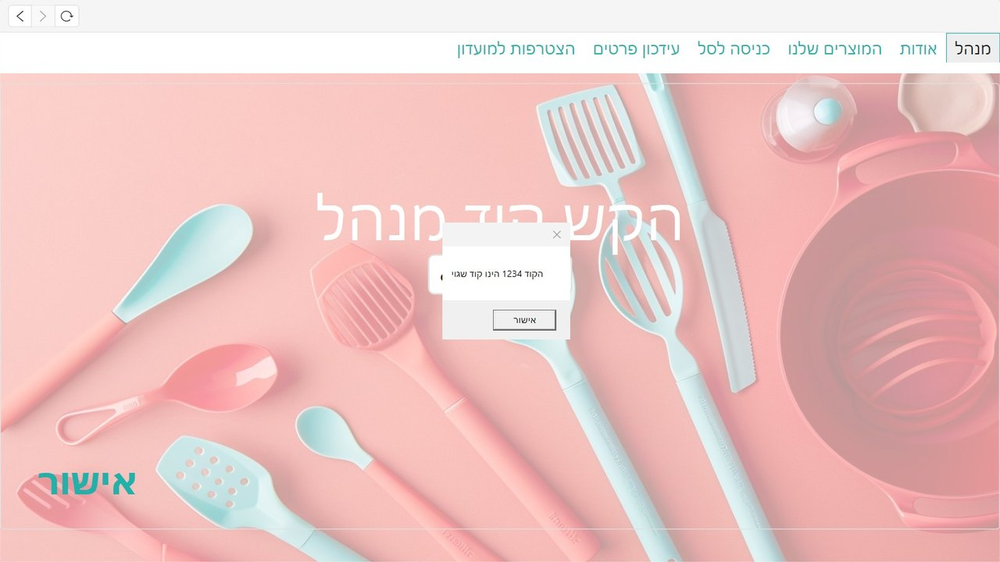
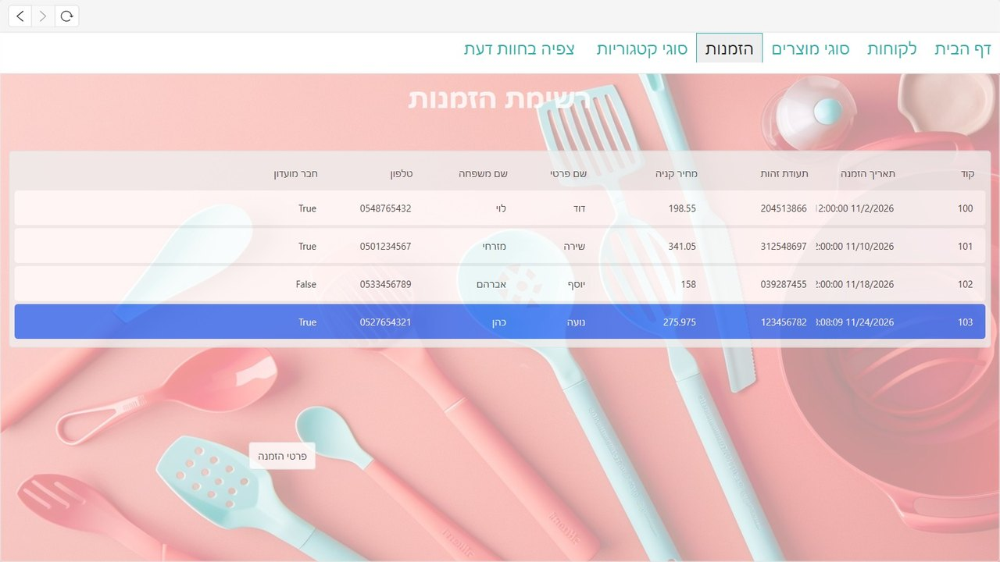
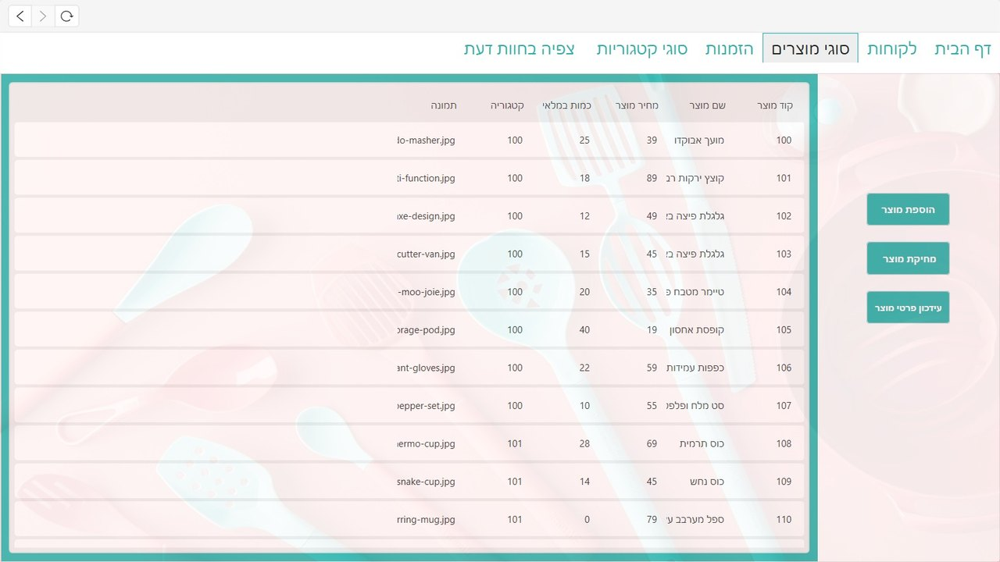

# 🏠 הכליק · Home Center

**מערכת חנות דסקטופ לכלי בית וגאדג'טים**, כתובה ב‑**C#** וב‑**WPF**. במערכת יש ממשק ללקוח וממשק נפרד למנהל. המערכת מכסה את כל התהליך: זיהוי לקוח, קטלוג, סל, מועדון לקוחות עם הנחות, תשלום מאומת וניהול מלא של מוצרים, הזמנות ולקוחות.

**טכנולוגיות:** `C#` · `.NET Framework 4.7.2` · `WPF / XAML` · `Entity Framework 6` · `SQL Server LocalDB` · `WCF`

---

## 🎬 סרטון הדגמה

<p align="center">
  <a href="https://github.com/user-attachments/assets/7a81dbd4-31b5-426a-a114-0e325d5a9f2b"></a>
</p>

https://github.com/user-attachments/assets/7a81dbd4-31b5-426a-a114-0e325d5a9f2b

> בסרטון רואים קנייה מלאה מתחילתה ועד סופה. ת"ז שגויה נדחית, ניסיון לחרוג מהמלאי נחסם, הלקוחה מצטרפת למועדון ומקבלת הנחת יום הולדת, כרטיס אשראי שגוי נדחה והתשלום עובר. בסוף נכנסים לממשק המנהל ורואים את ההזמנה החדשה ואת המלאי המעודכן.

---

## 📸 צילומי מסך

| | |
|:---:|:---:|
| <br>**דף הבית ואודות** | <br>**ת"ז לא תקינה נדחית** |
| <br>**קטלוג מוצרים עם סינון לפי קטגוריה** | <br>**חריגה מהמלאי נחסמת ("חסר במלאי")** |
| <br>**הסל, והצעה להצטרף למועדון** | <br>**הנחת חודש יום הולדת (30%)** |
| <br>**תשלום מאומת שבוצע בהצלחה** | <br>**כניסת מנהל: קוד שגוי נדחה** |
| <br>**ניהול הזמנות** | <br>**ניהול מוצרים ומלאי** |

---

## ✨ יכולות עיקריות

### 🛒 צד הלקוח
- **זיהוי לפי תעודת זהות.** המערכת מאמתת את ספרת הביקורת של ת"ז ישראלית, ות"ז שגויה נדחית.
- **קטלוג מוצרים.** המוצרים נטענים ממסד הנתונים עם תמונה, מחיר וקוד מוצר, ואפשר לסנן לפי קטגוריה.
- **בקרת מלאי בזמן אמת.** אי אפשר להוסיף לסל יותר יחידות ממה שיש במלאי.
- **סל קניות.** לכל פריט מוצגים הכמות, המחיר ליחידה והמחיר הכולל.
- **מועדון לקוחות:**
  - לקוח שאינו חבר מקבל הצעה להצטרף כשהוא עובר לתשלום.
  - חבר מועדון מקבל **5%** הנחה.
  - בחודש יום ההולדת המערכת מוסיפה לבד עוד **30%** הנחה.
- **תשלום מאובטח:**
  - המערכת מאמתת את מספר הכרטיס (קידומת 53, 16 ספרות ובדיקת Luhn).
  - אפשר לחלק לתשלומים כשהסכום מעל 200 ₪.
- **שמירת ההזמנה.** ההזמנה ופריטיה נשמרים במסד הנתונים, והמלאי מתעדכן אוטומטית.

### 🔐 צד המנהל
- **כניסה מוגנת בקוד מנהל.**
- **ניהול מוצרים וקטגוריות:** הוספה, עדכון ומחיקה, כולל העלאת תמונות.
- **צפייה בהזמנות ובפריטים של כל הזמנה.**
- **ניהול לקוחות** עם חיפוש מהיר לפי ת"ז.
- **צפייה בהודעות** שמגיעות משירות **WCF** נפרד.

---

## 🧰 טכנולוגיות וכלים

| תחום | טכנולוגיה | איך היא משמשת בפרויקט |
|------|-----------|-------------------------|
| **שפה** | **C#** | כל הלוגיקה: שכבת UI, שכבת BL ושירות ההודעות |
| **פלטפורמה** | **.NET Framework 4.7.2** | סביבת הריצה של כל הפתרונות |
| **ממשק משתמש** | **WPF + XAML** | ניווט בין דפים (`Page`) בתוך `Frame`, ממשק מימין לשמאל (RTL), `UserControl` לכל כרטיס מוצר ולכל שורה בסל |
| **אימות קלט** | **WPF `ValidationRule`** | כללי אימות מותאמים: גיל (`AgeRangeRule`), עברית בלבד, מספרים, ת"ז (`IdValidation`) |
| **אלגוריתמים** | **Luhn / ספרת ביקורת** | אימות ת"ז ישראלית ומספר כרטיס אשראי |
| **גישה לנתונים** | **Entity Framework 6 (Database First)** | מודל `Model1.edmx`, `DbContext` בשם `Entities4`, שאילתות **LINQ** |
| **מסד נתונים** | **SQL Server LocalDB** | קובץ `Databace.mdf` עם הטבלאות מוצרים, קטגוריות, לקוחות, ערים, הזמנות ופריטי הזמנה |
| **תקשורת** | **WCF** (`BasicHttpBinding`) | שירות הודעות עצמאי, מתארח ב‑`HOST` ונצרך דרך Service Reference |
| **ספריית UI** | **HandyControl** | רכיבי ממשק ועיצוב מודרני |
| **ספריות נוספות** | **System.Reactive** | Reactive Extensions |
| **סביבת פיתוח** | **Visual Studio 2022** | פיתוח, דיבוג ו‑NuGet |

---

## 🏗️ ארכיטקטורה

הפרויקט בנוי **בשכבות**: ממשק (UI), לוגיקה עסקית (BL) וגישה לנתונים (EF).

```
┌──────────────────────────────────────────────────────┐
│  UI (WPF Pages)    MainWindow → Frame → Page          │
│        │                                             │
│        ▼                                             │
│  BL (Services)     ClientService · ItemService ·      │
│                    OrderService · CategoryService ... │
│        │                                             │
│        ▼                                             │
│  DAL (EF6)         Globali.myDb  →  Entities4         │
│        │                                             │
│        ▼                                             │
│  SQL Server LocalDB  ·  Databace.mdf                  │
└──────────────────────────────────────────────────────┘

┌──────────────────────────────────────────────────────┐
│  MessageManager  →  WCF Service1 (HOST :8733)         │
│                          │                           │
│                          ▼                           │
│                  meddegedb.mdf (DB נפרד)              │
└──────────────────────────────────────────────────────┘
```

- **ניווט:** דפי `Page` בתוך `Frame`. ממשק הלקוח מתחיל ב‑`MainPage`, וממשק המנהל ב‑`director`.
- **גישה למסד הנתונים:** דרך `Globali.myDb`, מופע יחיד (singleton) של `Entities4`.
- **מצב הסשן:** `AllStatic.myClient` שומר את הלקוח המחובר, ו‑`AllStatic.myOrder` שומר את הסל הפעיל.

---

## 🔄 תהליך קנייה, מקצה לקצה

| שלב | רכיב | מה קורה |
|-----|------|---------|
| 1 | `pagebeforecast` | הלקוח מזין ת"ז, והקוד מריץ `IdValidation.ValidateId` |
| 2 | `ClientService.GetClient` | אם הלקוח קיים הוא נשמר ב‑`AllStatic.myClient`. אם לא, הוא עובר לרישום מהיר (`addclient2`) |
| 3 | `Pageofitem` + `UserControl1` | הלקוח בוחר קטגוריה וכמות, ולוחץ "הוסף לסל" (עם בדיקת מלאי) |
| 4 | `cart` | תצוגת הסל ומעבר לתשלום |
| 5 | `Club_card` | אם הלקוח לא חבר מועדון, הוא מקבל הצעה להצטרף, ואז `Member = true` |
| 6 | `payment` | חישוב ההנחות, אימות הכרטיס, `OrderService.AddOrder` ועדכון המלאי |

---

## 🗄️ מסד הנתונים

| ישות | שדות עיקריים |
|------|-------------|
| **Category** | `Code`, `Dedripition`, `Status` |
| **Item** | `NameItem`, `Price_base`, `Price_after`, `Amount`, `NameImage`, `Category` |
| **Client** | `Id`, `FirstName`, `LastName`, `Phone`, `Email`, `Stree`, `City`, `Member`, `Dateofbirth` |
| **City** | `codeCity`, `NameCity` |
| **Order** | `CodeOrder`, `Id`, `DateOrder`, `ArriveDate`, `PriceEnd`, `Delivery`, `Payment` |
| **ItemOrder** | `Code`, `CodeItem`, `CodeOrders`, `Amount` |
| **codedirector** | `code`, `password` |

---

## 📁 מבנה הפרויקט

```
HomeGadget/
├── home_center.sln            ← הפתרון הראשי: אפליקציית החנות
├── home_center/
│   ├── UI/                    ← דפי WPF (לקוח ומנהל)
│   ├── BL/                    ← שכבת הלוגיקה העסקית (Services)
│   ├── model/                 ← Entity Framework (Database First)
│   ├── MyPicture/             ← תמונות המוצרים
│   └── Connected Services/    ← הפניות לשירות ה‑WCF
└── Messege/                   ← מערכת ההודעות (פתרון נפרד)
    ├── Messege/               ← שירות WCF
    ├── HOST/                  ← אירוח השירות
    └── MessageManager/        ← אפליקציה לשליחת הודעות
```

---

## ▶️ הרצה

**דרישות:** Windows, Visual Studio 2017 ומעלה (מומלץ 2022), .NET Framework 4.7.2, SQL Server LocalDB (`(LocalDB)\MSSQLLocalDB`).

### האפליקציה הראשית
1. פותחים את `home_center.sln`.
2. משחזרים את חבילות ה‑NuGet (Restore NuGet Packages).
3. מצרפים מסד נתונים בשם `Databace.mdf` לתיקייה `bin\Debug`. הקובץ לא נמצא ב‑repo, כי הוא מוחרג ב‑`.gitignore`.
4. מגדירים את `home_center` כפרויקט ההפעלה ולוחצים **F5**.

### מערכת ההודעות (לא חובה)
1. פותחים את `Messege/Messege.sln` ומריצים את `HOST`. השירות עולה על פורט `8733`.
2. מריצים את `MessageManager/MessageManager.sln` כדי לשלוח הודעות.

> **קוד מנהל ברירת מחדל:** `25`
